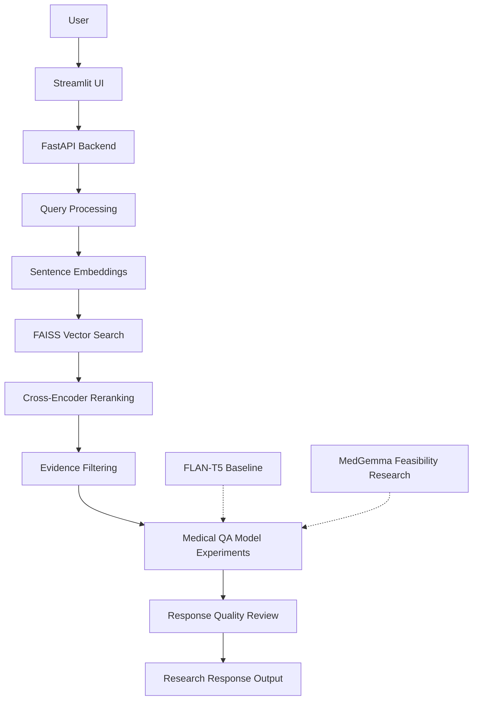
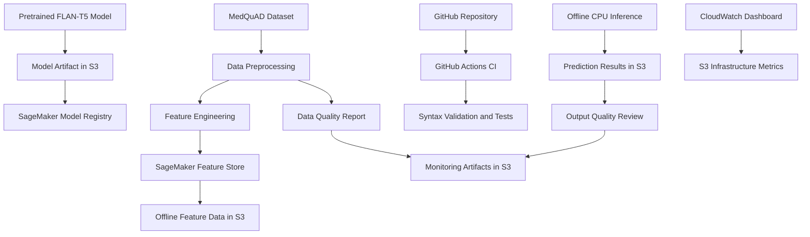
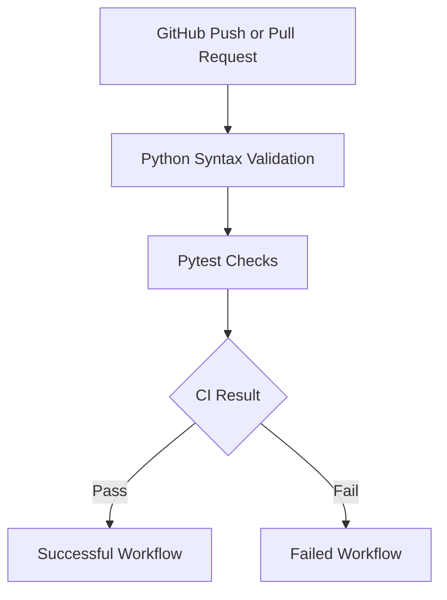

# MedQuad AI
### Evidence-Grounded Medical Question Answering | Applied AI Research & MLOps

**University of San Diego**  
Shiley-Marcos School of Engineering  
**MSc in Applied Artificial Intelligence — AAI-540 Final Project**

**Project Team**
- Abhay Srivastav
- Chandra Mouli Mudumba
- Rahul Pawar

**Project Status:** Academic Research Prototype  
**Clinical Validation:** Not validated

**Kaggle Dataset Link:** https://www.kaggle.com/datasets/pythonafroz/medquad-medical-question-answer-for-ai-research

---

## 1. Project Overview

**MedQuad AI** is a medical question-answering research project designed to investigate the reliability of artificial intelligence in healthcare information retrieval.

The system explores how **Retrieval-Augmented Generation (RAG)**, language models, medical datasets, and AWS machine learning operations can support evidence-grounded medical question answering.

The project focuses on:

- Medical question answering and factuality
- Retrieval relevance and evidence grounding
- Language model experimentation
- Data preprocessing and feature engineering
- Cloud-based machine learning infrastructure
- CI/CD and model governance
- Data quality and model-output monitoring
- Healthcare AI security, privacy, and ethics

**Important:** MedQuad AI is an educational research prototype, not a diagnostic system or clinically validated medical application.

---

## 2. Technology Stack

| Layer | Technology | Purpose |
|---|---|---|
| Frontend | Streamlit | Interactive medical chatbot interface |
| Backend | FastAPI | API endpoints and application logic |
| Programming | Python | Data processing and AI development |
| Dataset | MedQuAD | Medical question-answering research |
| Embeddings | Sentence Transformers | Semantic representations |
| Vector Search | FAISS | Medical passage retrieval |
| Reranking | Cross-Encoder | Improve retrieved evidence relevance |
| Language Model | FLAN-T5 Small | Pretrained baseline and experiments |
| Medical Model Research | MedGemma 4B IT | Medical LLM feasibility investigation |
| Cloud Platform | AWS SageMaker AI | Model governance and research infrastructure |
| Feature Management | SageMaker Feature Store | Feature group and offline feature storage |
| Model Governance | SageMaker Model Registry | Model version registration |
| Storage | Amazon S3 | Models, datasets, and research artifacts |
| Monitoring | Amazon CloudWatch | Infrastructure dashboard |
| CI | GitHub Actions | Automated syntax validation and tests |
| Version Control | GitHub | Source code and experiment documentation |

---

## 3. System Architecture and Workflow

The project separates the user-facing application, retrieval pipeline, model experimentation, and MLOps infrastructure.

### 3.1 Application and AI Workflow



**Implementation note:** The diagram represents the intended application and research architecture. The repository contains Streamlit, FastAPI, retrieval, and model-experiment components, but complete end-to-end deployment and integration have not been independently validated.

### 3.2 AWS MLOps Workflow



The AWS workflow demonstrates feature management, model registration, offline inference, continuous integration, and monitoring configuration. It is not a fully automated production deployment pipeline.

---

## 4. Streamlit Frontend

**Technology:** Streamlit

**Repository:** [`frontend/`](frontend/)

The Streamlit frontend provides the user-interface components for the MedQuad AI application.

### Frontend Components

- Medical chatbot interface
- User interaction and question submission
- Chat display and response presentation
- Authentication-related screens
- Login and signup components
- Interface styling and navigation

The frontend is designed to communicate with the FastAPI backend.

**Status:** Frontend source code implemented in the repository. Production deployment and complete end-to-end integration are not claimed.

---

## 5. FastAPI Backend

**Technology:** FastAPI

**Repository:** [`backend/`](backend/)

The backend provides application and API logic for the MedQuad AI system.

### Backend Responsibilities

- API request handling
- Frontend/backend communication
- Authentication-related application logic
- Session-management components
- Integration points for retrieval and inference services

### Backend Structure

- `backend/main.py`
- `backend/auth/`
- `backend/auth/service.py`
- `backend/auth/session_security.py`

**Status:** Backend implementation files are present. Full API deployment and production security validation remain future work.

---

## 6. Medical Dataset and Data Engineering

### 6.1 MedQuAD Dataset

The project uses the **MedQuAD medical question-answering dataset**, sourced from NIH-related health information resources.

| Processing stage | Records |
|---|---:|
| Cleaned medical question-answer pairs | 16,359 |
| Processed retrieval passages | 38,544 |

### 6.2 Data Processing

The project includes:

- Data ingestion
- Missing-value handling
- Duplicate removal
- Data cleaning
- Medical passage preparation
- Feature engineering
- Exploratory data analysis

**Repository:** [`src/data/`](src/data/)

### 6.3 Data Quality Results

| Metric | Result |
|---|---:|
| Total retrieval passages | 38,544 |
| Duplicate rows | 0 |
| Missing monitored values | 0 |
| Average token length | 149.21 |
| Median token length | 163 |
| Maximum token length | 240 |
| Configured data-quality checks | PASS |

**Evidence:** [Data Quality Report](monitoring/reports/medquad_data_quality_report.json)

These results measure configured data-quality properties, not medical correctness.

---

## 7. Retrieval-Augmented Generation (RAG)

The project investigates retrieval-based evidence selection for medical question answering.

### Retrieval Pipeline

1. Medical question processing
2. Sentence embedding generation
3. FAISS vector similarity search
4. Cross-encoder reranking
5. Evidence filtering
6. Context preparation for language model experiments

### Preliminary Retrieval Evaluation

| Retrieval method | Precision@5 |
|---|---:|
| FAISS retrieval | 30% |
| FAISS with reranking | 42% |

The results are preliminary and based on a limited evaluation sample. They do not represent clinical accuracy or a comprehensive benchmark.

**Research Notebook:** [RAG Retrieval Evaluation](notebooks/rag_retrieval_evaluation.ipynb)

---

## 8. Language Models — FLAN-T5 and MedGemma

### 8.1 FLAN-T5 Small

**Model:** `google/flan-t5-small`

FLAN-T5 Small was investigated as a lightweight text-generation baseline.

The pretrained model was:

- Loaded using CPU resources
- Saved as a model artifact
- Uploaded to Amazon S3
- Registered in SageMaker Model Registry
- Used for a small offline inference demonstration

**Model Registry Group:** `medquad-flan-t5-models`  
**Model Version:** `1`  
**Registration Status:** `Completed`  
**Approval Status:** `PendingManualApproval`

**Important:** The registered checkpoint is a pretrained FLAN-T5 baseline, not a verified MedQuAD-fine-tuned model.

### 8.2 FLAN-T5 Medical Factuality Findings

Five predictions were generated using two unique medical questions.

| Review category | Outputs |
|---|---:|
| Factually incorrect | 3 |
| Circular or uninformative | 2 |
| Total reviewed | 5 |

The model generated medically unreliable responses, including an incorrect description of glaucoma.

These observations demonstrate baseline limitations, not a statistically representative accuracy score.

**Evidence:**
- [Batch Inference Results](inference/outputs/flan_t5_batch_predictions.json)
- [Model Output Quality Report](monitoring/reports/medquad_model_output_quality_report.json)

### 8.3 MedGemma Research

**Model investigated:** `google/medgemma-4b-it`

The MedGemma investigation includes:

- Model repository access verification
- AWS SageMaker hardware assessment
- Medical RAG prompt experiments
- Evidence filtering
- Inference feasibility analysis

AWS Academy permissions and available CPU resources limited the experiments.

**Status:** Research and feasibility investigation. Successful MedGemma deployment or clinically validated inference has not been established.

**Research Notebook:** [MedGemma Inference Research](notebooks/medgemma_inference.ipynb)

---

## 9. AWS SageMaker AI and MLOps

**AWS Region:** `us-east-1`

### 9.1 SageMaker Feature Store

**Feature Group:** `medquad-feature-group`

Features include:

- `record_id`
- `question`
- `source`
- `focus_area`
- `input_token_length`
- `target_token_length`
- `event_time`

**Verified implementation:**
- Feature Group created successfully
- 10 feature records submitted
- 10 offline Parquet files observed in Amazon S3

This is a small-scale Feature Store demonstration, not full-dataset ingestion.

### 9.2 SageMaker Model Registry

**Model Package Group:** `medquad-flan-t5-models`

| Property | Value |
|---|---|
| Model | FLAN-T5 Small pretrained baseline |
| Version | 1 |
| Package status | Completed |
| Approval status | PendingManualApproval |
| Model storage | Amazon S3 |

The registered model artifact is located at:

`s3://medquad-ai-cleaned/models/flan-t5-small-baseline/model.tar.gz`

Registration does not establish successful endpoint deployment or inference-container compatibility.

### 9.3 Amazon S3 Storage

**Bucket:** `medquad-ai-cleaned`

Amazon S3 stores:

- Model artifacts
- Offline Feature Store data
- Batch prediction outputs
- Data-quality reports
- Model-output review reports

### 9.4 Amazon CloudWatch

**Dashboard:** `MedQuad-AI-Infrastructure-Monitoring`

Configured widgets:

- S3 Bucket Storage Size
- S3 Number of Objects

The dashboard was successfully created and viewed. At the time of capture, the S3 metric graphs showed no available data.

No live SageMaker inference endpoint or managed Model Monitor schedule was running.

---

## 10. CI/CD — GitHub Actions

**Workflow:** [MedQuad AI CI](.github/workflows/medquad-ci.yml)

The project implements continuous integration using GitHub Actions.

### CI Workflow



### Verified CI Evidence

| CI demonstration | Result |
|---|---|
| Main branch workflow | Passed |
| Intentional failure demonstration | Failed |
| Python syntax unit test | Passed locally |

The failed workflow was created on a separate demonstration branch and was not intended to be merged into `main`.

**Unit Test:** [Python Syntax Test](tests/test_python_syntax.py)

**GitHub Actions:** [View Workflow Runs](https://github.com/McChandra/medical_chatbot/actions)

**Scope:** The current workflow provides CI validation. Automated AWS deployment, retraining, and infrastructure provisioning are not implemented as continuous delivery.

---

## 11. Model Inference and Monitoring

### 11.1 Offline Batch Inference

Five FLAN-T5 baseline predictions were generated locally using CPU resources and uploaded to S3.

**Evidence:** [FLAN-T5 Predictions](inference/outputs/flan_t5_batch_predictions.json)

This demonstrates offline batch-style inference, not a managed SageMaker Batch Transform job.

### 11.2 Data Quality Monitoring

The data-quality report measures:

- Missing values
- Duplicate records
- Token-length statistics
- Source distribution
- Configured validation checks

**Result:** PASS

### 11.3 Model Output Quality Review

The model-output report documents:

- Observed factual errors
- Circular responses
- Reviewed questions and predictions
- Clinical readiness limitations

**Clinical readiness:** NOT_VALIDATED

These reports are offline monitoring artifacts rather than SageMaker Model Monitor processing-job outputs.

---

## 12. Healthcare AI Security and Ethics

MedQuad AI considers healthcare-specific risks and responsible AI practices.

### Key Considerations

**Patient Privacy**
- Avoid real patient records and identifiable health information
- Use public research data for demonstrations
- Protect sensitive information in any future deployment

**Authorization**
- General-user and healthcare-professional access separation is a design objective
- Production-grade authorization has not been independently audited

**Medical Safety**
- Non-diagnostic system behavior
- Human oversight
- Factuality checks and evidence grounding
- Clear communication of uncertainty
- Avoidance of unsupported medical recommendations

**AWS Security**
- Least-privilege IAM
- Controlled S3 access
- Secrets management
- Encryption and audit logging as deployment requirements

**Healthcare Regulations**

HIPAA and other healthcare policies are design considerations. The project does not claim verified HIPAA compliance.

---

## 13. Project Repository Structure

```text
medical_chatbot/
├── .github/workflows/      # GitHub Actions CI
├── backend/                # FastAPI backend
├── frontend/               # Streamlit interface
├── features/               # Feature engineering
├── models/                 # ML and retrieval scripts
├── src/data/               # Data ingestion and preprocessing
├── src/inference/          # Inference experiments
├── deployment/             # Deployment research
├── notebooks/              # Research notebooks
├── monitoring/reports/     # Data and model quality reports
├── inference/outputs/      # Batch prediction evidence
├── tests/                  # Automated tests
├── requirements.txt        # Dependencies
└── README.md               # Project documentation
```

---

## 14. Installation and Development

### Clone Repository

```bash
git clone https://github.com/McChandra/medical_chatbot.git
cd medical_chatbot
```

### Create Python Environment

```bash
python -m venv .venv
source .venv/bin/activate
```

On Windows:

```bash
.venv\Scripts\activate
```

### Install Dependencies

```bash
pip install -r requirements.txt
```

### Run Unit Tests

```bash
python -m pip install pytest
python -m pytest tests/test_python_syntax.py -q
```

Some experiments require additional datasets, model downloads, AWS permissions, or dependencies. A complete fresh-clone deployment has not been verified.

---

## 15. Research Limitations

The project currently has several limitations:

1. The registered FLAN-T5 model is a pretrained baseline.
2. FLAN-T5 produced medically unreliable answers.
3. MedGemma deployment was not successfully established.
4. Retrieval evaluation used a limited sample.
5. The system has not been clinically validated.
6. No production SageMaker endpoint is running.
7. No managed SageMaker Model Monitor schedule is running.
8. GitHub Actions implements CI, not automated AWS deployment.
9. Feature Store ingestion was demonstrated using 10 records.
10. The CloudWatch dashboard did not yet display populated metric graphs.

---

## 16. Future Research and Development

Future work includes:

- Medical model fine-tuning and comparative evaluation
- Improved RAG grounding and evidence attribution
- Hallucination detection and factuality evaluation
- Confidence-aware abstention
- Clinician-reviewed evaluation datasets
- Secure role-based authorization
- Automated monitoring and drift detection
- Scalable AWS deployment
- Production CI/CD and infrastructure automation
- Healthcare privacy and regulatory assessment

---

## 17. AAI-540 Final Submission Deliverables

### Deliverable 1 — ML System Design Document

The technical report should cover:

- Business and research problem
- Research objectives and impact metrics
- Dataset and data engineering
- Feature engineering
- Model selection and experiments
- Retrieval and model evaluation
- System architecture
- Deployment strategy and constraints
- Monitoring and observability
- CI/CD
- Security, ethics, and limitations
- GitHub repository reference

### Deliverable 2 — Narrated Demonstration Video

Target duration: **9–10 minutes**

Suggested demonstration sequence:

1. Project overview and research problem
2. Streamlit UI and FastAPI architecture
3. Data processing and RAG pipeline
4. FLAN-T5 and MedGemma experiments
5. SageMaker Feature Store
6. SageMaker Model Registry
7. GitHub Actions successful and failed runs
8. Batch inference and monitoring reports
9. CloudWatch dashboard
10. Research limitations and team contributions

Demonstrations should clearly distinguish completed AWS operations from experimental, offline, or proposed functionality.

### Deliverable 3 — Complete GitHub Repository

Repository includes:

- Application source code
- Data processing scripts
- Feature engineering
- Model experimentation code
- Research notebooks
- CI workflow
- Automated tests
- Inference results
- Monitoring reports
- AWS artifact references
- Project documentation

### Deliverable 4 — Individual Peer Evaluation

Each team member completes the individual peer evaluation required by the course.

---

## 18. Academic Credits

**University of San Diego**  
**Shiley-Marcos School of Engineering**  
**MSc in Applied Artificial Intelligence**

**Project Team**
- Abhay Srivastav
- Chandra Mouli Mudumba
- Rahul Pawar

**GitHub Repository:** https://github.com/McChandra/medical_chatbot

---

### Medical Disclaimer

MedQuad AI is intended solely for academic research and educational demonstration. It is not a clinically validated medical device, diagnostic system, or substitute for professional medical advice. Generated responses must not be used to make diagnosis, treatment, prescription, or emergency-care decisions.
