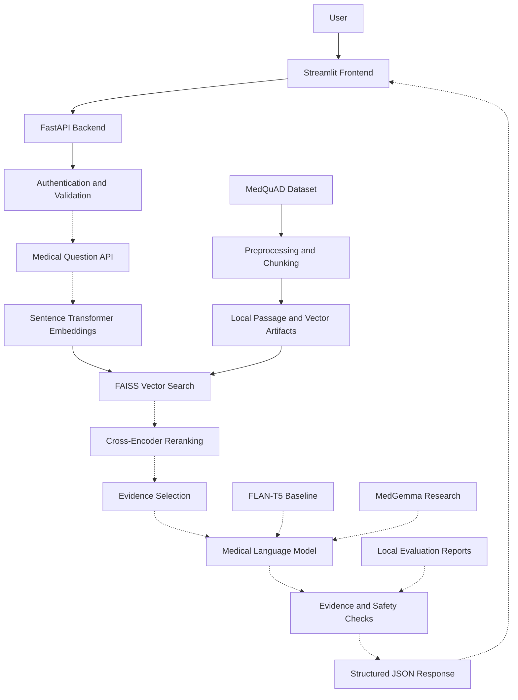

# MedQuad AI — System Architecture

## 1. Project Overview

MedQuad AI is an academic research prototype for evidence-grounded medical question answering.

The project investigates how Retrieval-Augmented Generation (RAG), medical language models, and structured evidence retrieval can support reliable access to medical information.

MedQuad AI is not a clinically validated diagnostic system.

## 2. Architecture Overview

The system is organized into five layers:

1. **Presentation Layer — Streamlit**
   - User authentication screens
   - Medical question submission
   - Response page
   - Light and dark themes

2. **Application Layer — FastAPI**
   - Authentication and session management
   - Request validation
   - Future medical question-answering API

3. **Retrieval Layer — Sentence Transformers and FAISS**
   - Generate semantic embeddings
   - Retrieve relevant MedQuAD passages
   - Experiment with cross-encoder reranking

4. **Generation Layer — Medical Language Models**
   - FLAN-T5 Small: evaluated pretrained baseline
   - MedGemma 4B IT: feasibility research
   - Future evidence-grounded response generation

5. **Storage and Evaluation Layer**
   - Local dataset and retrieval artifacts
   - Model and experiment outputs
   - Data-quality and model-output reports
   - Future persistent chat history and saved answers

## 3. Current Implementation Status

The repository includes a Streamlit interface, FastAPI authentication components, offline retrieval experiments, and baseline model evaluation.

The medical response page currently displays a placeholder.

The complete retrieval-to-generation-to-frontend workflow is not yet integrated or clinically validated.

## 4. Development Environment

- IDE: Visual Studio Code
- Language: Python
- Frontend: Streamlit
- Backend: FastAPI
- Retrieval: Sentence Transformers and FAISS
- Testing: pytest
- Version Control: Git and GitHub
- CI: GitHub Actions

Development is performed locally without requiring AWS SageMaker.


## 5. System Architecture Diagram

The following diagram represents the target architecture.
Dashed connections indicate components that are not yet fully integrated.



### Implementation Status

- **Implemented:** Streamlit UI, FastAPI authentication, MedQuAD preprocessing, offline FAISS retrieval experiments, and evaluation reports.
- **Experimental:** Cross-encoder reranking and FLAN-T5 baseline generation.
- **Planned:** Medical question API, integrated evidence-grounded generation, response verification, and structured JSON output.
- **Research only:** MedGemma integration and future clinical applications.


## 6. Medical Question API Response Contract

### Endpoint (Planned)

POST /api/v1/medical/questions

### Request Example

```json
{
  "question": "What is endocarditis?"
}
```

### Response Example

```json
{
  "request_id": "example-001",
  "question": "What is endocarditis?",
  "status": "pending_evidence",
  "medical_explanation": {
    "summary": null,
    "symptoms": [],
    "when_to_seek_care": null,
    "prevention": null
  },
  "sources": [],
  "educational_videos": [],
  "pubmed_studies": [],
  "safety": {
    "is_diagnostic": false,
    "requires_clinician_review": true,
    "disclaimer": "For educational purposes only. Not a diagnosis or substitute for professional medical advice."
  }
}
```

### Response Fields

| Field | Purpose |
|---|---|
| request_id | Identifies an individual request |
| question | Original user question |
| status | Processing or evidence availability status |
| medical_explanation | Structured educational explanation |
| sources | Supporting medical references |
| educational_videos | Relevant educational video references |
| pubmed_studies | Relevant medical research references |
| safety | Non-diagnostic restrictions and warnings |

### Design Rules

1. The backend must return a consistent JSON structure.
2. Medical claims must be supported by appropriate evidence.
3. The system must not fabricate citations or PubMed identifiers.
4. Missing evidence must be represented explicitly.
5. The frontend must handle empty lists and null values.
6. The API must not present unverified generated content as established medical fact.

### Implementation Status

This contract is a proposed design. The medical question endpoint and integrated response pipeline have not yet been implemented.
